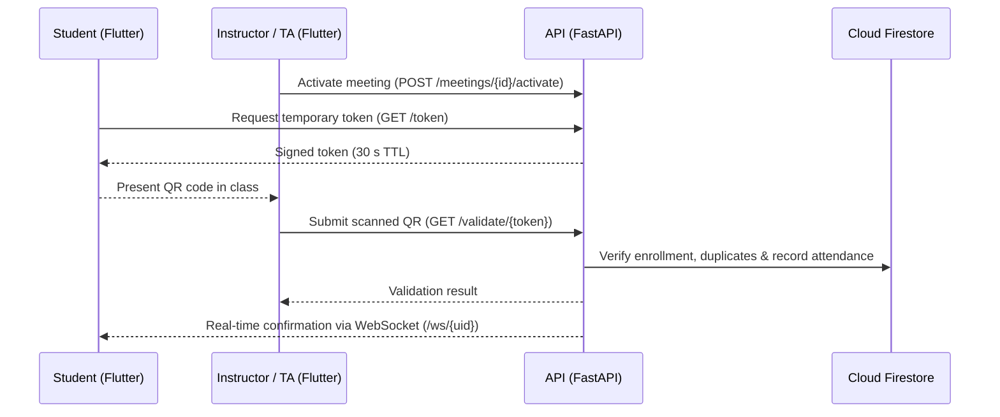
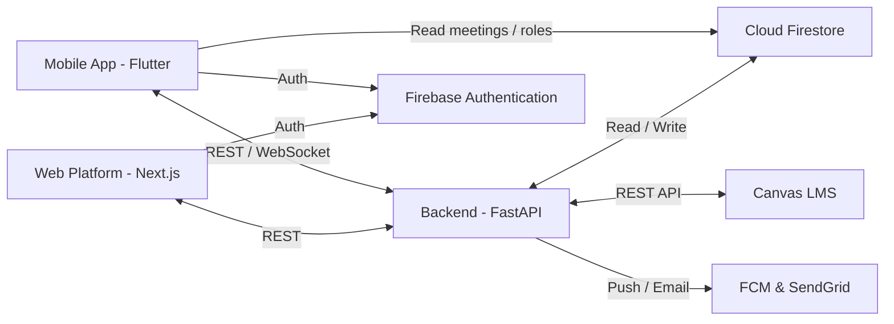
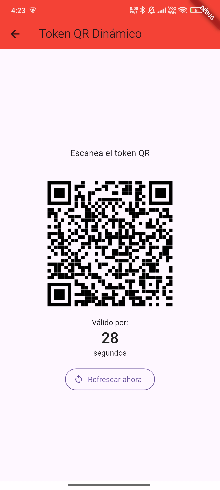
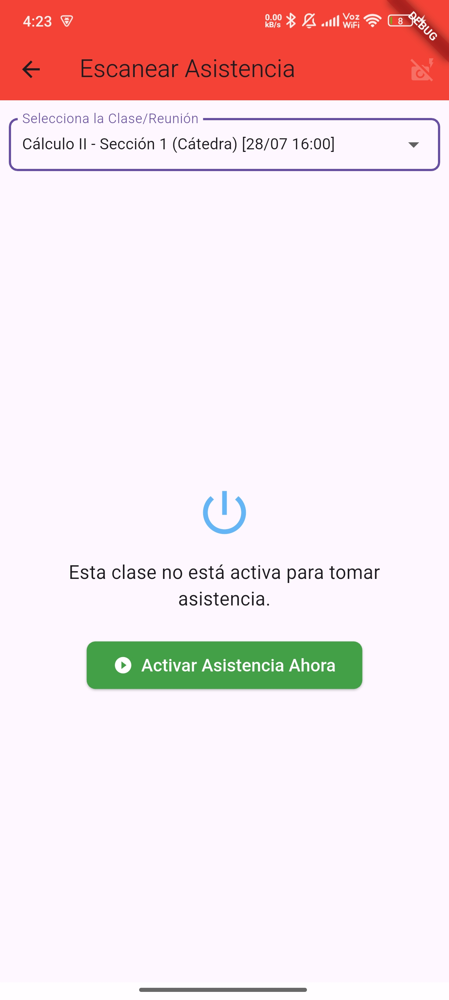
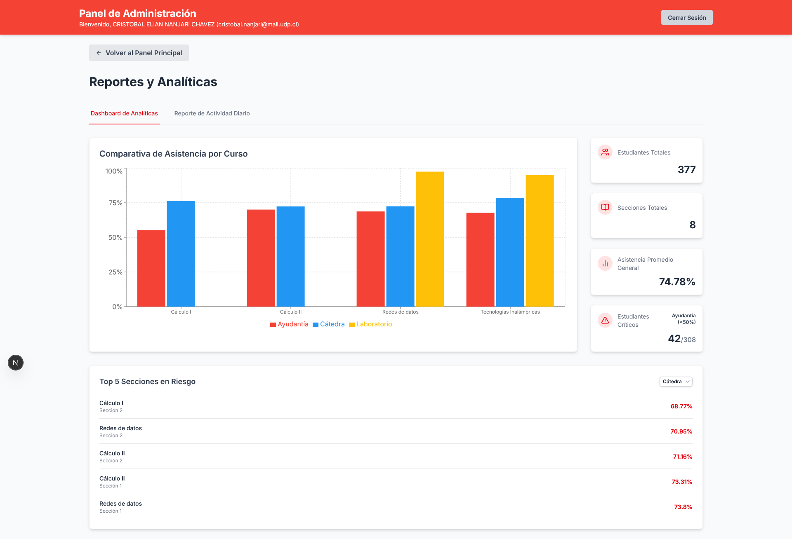
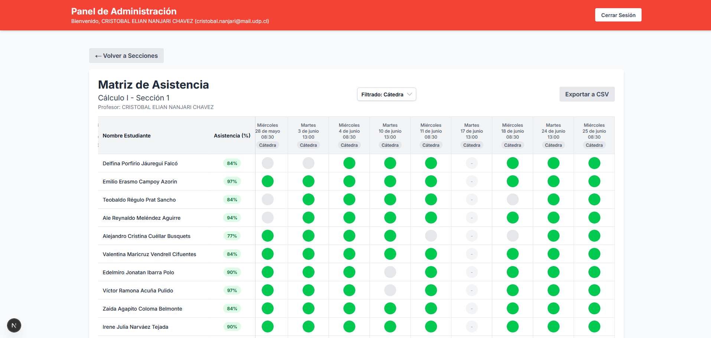

[Español](README.md) · **English** · [Portfolio case study](https://cristobal-nanjari.vercel.app/en/projects/udp-attendance)

# Academic Attendance System

Full-stack platform for in-person university attendance tracking using short-lived signed QR codes, real-time WebSocket confirmation, academic analytics, and bidirectional **Canvas LMS** integration.

The student **displays** a cryptographically signed QR token (30-second TTL) in the mobile app and the instructor or teaching assistant **scans** it. Recorded entries feed the web attendance matrix, daily reports, threshold-based early warnings, and grade synchronization with Canvas.

Developed as an undergraduate degree thesis in **Computer Science and Telecommunications Engineering** at **Universidad Diego Portales (2025)**, using its Faculty of Engineering and Sciences as the case study.

> **Publication scope:** consolidated monorepo published for code review and portfolio presentation. The original institutional deployment is retired (no live demo), and production credentials have been replaced with `.env.example` templates.

---

## End-to-End Flow: Classroom to Report

1. **In-class activation:** an authorized instructor or teaching assistant selects the current scheduled meeting for their section and activates attendance (triggering an FCM push notification to enrolled students).
2. **Dynamic QR token (30 s TTL):** the authenticated student requests a cryptographically signed token (`itsdangerous` / `URLSafeTimedSerializer`) and shows it as a QR code with a live countdown.
3. **Validation & real-time confirmation:** the instructor or assistant scans the QR; the backend verifies signature, expiration, section enrollment, and duplicates, persists the record in Cloud Firestore, and pushes instant confirmation to the student over **WebSocket**.
4. **Management, analytics & LMS:** in the web platform, instructors and administrators review or manually adjust the attendance matrix (unactivated sessions never count as absences), inspect daily reports, generate early-warning snapshots, export CSV/Excel files, and sync courses and grades with Canvas LMS.

---

## Architecture & Monorepo Modules

Each component includes its own technical documentation, code map, and local setup instructions:

| Module | Primary stack | Responsibility | Documentation | Entry points |
| :--- | :--- | :--- | :--- | :--- |
| **[`mobile/`](mobile/)** | Flutter · Dart `^3.7.2` · Firebase | Institutional sign-in, temporary QR generation, WebSocket, class activation, and QR scanner | [Mobile README](mobile/README.md) | [`qr_generator.dart`](mobile/lib/qr_generator.dart) · [`qr_validator.dart`](mobile/lib/qr_validator.dart) |
| **[`backend/`](backend/)** | Python · FastAPI · Firestore · APScheduler | Signed tokens, validation, role permissions, reports, alerts, notifications, and Canvas LMS | [Backend README](backend/README.md) | [`back.py`](backend/back.py) · [`lms_canvas_client.py`](backend/lms_canvas_client.py) |
| **[`web/`](web/)** | Next.js `15.3.2` · React 19 · TypeScript · Tailwind v4 | Course/section management, attendance matrix, analytics (`Recharts`), CSV/XLSX exports, and Canvas UI | [Web README](web/README.md) | [`dashboard/`](web/src/app/dashboard/) · [`apiClient.ts`](web/src/lib/apiClient.ts) |

---

## System Interfaces

### Mobile Application (Flutter)

<table>
  <tr>
    <td align="center" width="50%">
      
       
      <strong>Dynamic QR token:</strong> 30-second expiration, automatic refresh, and WebSocket confirmation.
    </td>
    <td align="center" width="50%">
      
       
      <strong>In-class activation:</strong> scheduled meeting selector and attendance activation by the instructor.
    </td>
  </tr>
</table>

### Administrative Web Platform (Next.js)

<strong>Reports & Analytics:</strong> course comparison by session type (Lecture, Recitation, Lab), overall KPIs, and top at-risk sections.

<strong>Attendance Matrix:</strong> per-session tracking distinguishing unactivated classes (<code>-</code>), audited manual overrides, and CSV export.

Original thesis captures (2025) rendered with synthetic test data. The displayed QR code is an expired test token from a retired backend. Additional screenshots are available in <a href="mobile/README.md"><code>mobile/README.md</code></a> and <a href="web/README.md"><code>web/README.md</code></a>.

---

## Pilot & Thesis Evaluation

- **Classroom pilot:** piloted across **5 academic sections (~40 students per section)** with the thesis advisor.
- **Documented evaluation:** the 2025 thesis covers faculty capacity modeling, a functional/security validation matrix, and synthetic load testing. Full documentation and the thesis PDF are available in the [portfolio case study](https://cristobal-nanjari.vercel.app/en/projects/udp-attendance).
- **Early warnings:** computed through periodic historical snapshots against a configurable attendance threshold (not predictive modeling).

---

## Local Setup (Isolated Environment)

The source code, diagrams, and screenshots can be inspected without credentials. To run each component in your own isolated environment (never pointing to institutional services), follow the component-level guides:

| Module | Main requirements | Detailed guide |
| :--- | :--- | :--- |
| `backend/` | Python 3 + `venv`, own Firebase project (`GOOGLE_APPLICATION_CREDENTIALS`), and `backend/.env` | [`backend/README.md`](backend/README.md) |
| `web/` | Node.js compatible with Next.js `15.3.2`, npm, and `web/.env.local` | [`web/README.md`](web/README.md) |
| `mobile/` | Stable Flutter (`Dart ^3.7.2`), FlutterFire (`firebase_options.dart`), and `--dart-define=API_BASE_URL=...` | [`mobile/README.md`](mobile/README.md) |

> Before exposing any self-hosted deployment on a network, review the academic domain restriction (`@mail.udp.cl`), `APScheduler` background jobs, Firestore security rules, and WebSocket endpoint authorization.

---

## Authorship & Licensing

- **Author:** **Cristóbal Nanjarí** — [Portfolio](https://cristobal-nanjari.vercel.app/en) · [Case study](https://cristobal-nanjari.vercel.app/en/projects/udp-attendance) · [GitHub](https://github.com/cristobal-nan)
- **Origin:** monorepo consolidation of the three independent repositories built for the thesis *Propuesta y desarrollo de sistema integral de registro de asistencia a clases en línea* (UDP, 2025).
- **License:** all rights reserved by the author unless a `LICENSE` file is added to the repository (published for portfolio code review). Third-party dependencies retain their respective licenses; see the [Flutter notice](docs/notices/Flutter.txt).
