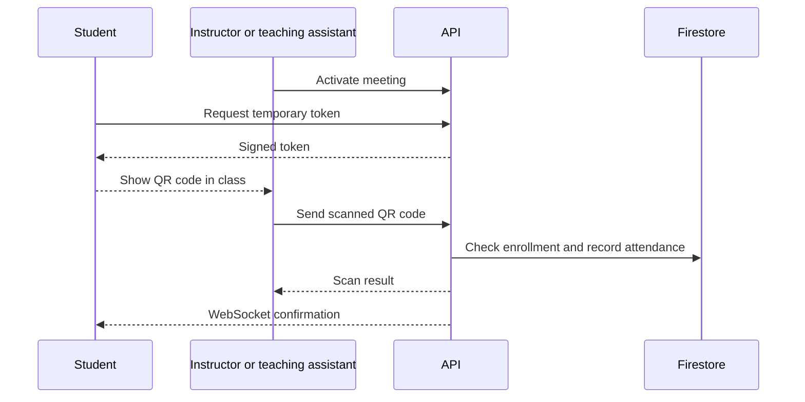
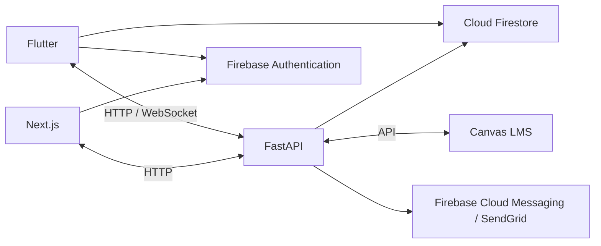

# Academic Attendance System

[Español](README.md) · **English** · [Portfolio project](https://cristobal-nanjari.vercel.app/projects/udp-attendance)

A mobile app records attendance in in-person classes; a web platform lets instructors and administrators review and correct attendance by section. The student **shows** their QR code and the instructor or teaching assistant **scans** it. The same records feed reports, low-attendance alerts and the Canvas LMS integration.

Developed as a degree project in Computer Science and Telecommunications Engineering at Universidad Diego Portales (2025), with its Faculty of Engineering and Sciences as the case study. **Status:** portfolio edition for code review. The original backend is retired and there is no live demo.

## From classroom to report

1. An authorized instructor or teaching assistant selects and activates their section’s class meeting.
2. The student requests a short-lived signed token and displays it as a QR code. When the instructor or assistant scans it, the backend checks the signature, expiration, enrollment and duplicate records.
3. Firestore stores the attendance record against the meeting. The student receives confirmation over a WebSocket. If the student cannot use their phone, the instructor can correct the record in the web attendance matrix for an active meeting.
4. The web platform calculates attendance percentages by meeting type. A class that was never activated does not count as an absence. Daily reports and threshold-based alerts support attendance reviews throughout the semester.

## Architecture and code

| Component | Responsibility | Start here |
|---|---|---|
| [Mobile](mobile/) · Flutter / Dart | Sign-in, temporary QR codes, class activation and scanning | [Generation](mobile/lib/qr_generator.dart) · [Validation](mobile/lib/qr_validator.dart) |
| [Backend](backend/) · Python / FastAPI | Attendance validation, permissions, reports, notifications and LMS integration | [API](backend/back.py) · [Canvas client](backend/lms_canvas_client.py) |
| [Web](web/) · Next.js / React / TypeScript | Course and section management, filterable matrix, analytics and CSV/XLSX exports | [Dashboard](web/src/app/dashboard/) · [HTTP client](web/src/lib/apiClient.ts) |

The Canvas integration imports courses, instructors, students and schedules, and can publish attendance percentages as assignment grades. Early warnings use a configurable threshold; they do not predict academic performance.

## Interfaces from the degree project

| Activate attendance | Scan the student’s QR code |
|---|---|
|  |  |

Cropped from thesis figures B.17, B.18 and B.7 (2025). They show the historical interfaces and contain neither a usable QR code nor student lists.

## Pilot and scope of evaluation

According to the author, the thesis advisor piloted the system across **5 class sections, with approximately 40 students per section**. This describes the scope of the pilot, not a count of unique users. The thesis includes a capacity estimate and a test plan. No verified load or latency measurements are reported for this edition.

## Local review and runtime requirements

The code, diagrams and screenshots can be reviewed without credentials. The following commands describe each component’s entry points; **they are not a validated demo**. Do not connect to institutional services or use credentials from the original project.

| Directory | Configuration for your own isolated environment | Reference commands |
|---|---|---|
| `mobile/` | Stable Flutter with Dart `^3.7.2`; Android SDK or macOS/Xcode for iOS. Generate `lib/firebase_options.dart` and native configuration with FlutterFire for your own project. Supply an API URL reachable from the device. | `flutter pub get` · `flutter run --dart-define=API_BASE_URL=http://10.0.2.2:8000` (Android emulator) |
| `backend/` | Python virtual environment; version not pinned. See the [environment template](backend/.env.example). A new signing secret and a credential file outside the repository are required. Review the scheduler before startup: it can write to Firestore and send notifications. | `python -m pip install -r requirements.txt` · `python -m uvicorn back:app --host 127.0.0.1 --port 8000` |
| `web/` | Node compatible with Next.js 15.3.2 and npm. Configure `.env.local` using the [web template](web/.env.example). `NEXT_PUBLIC_*` variables are exposed to the browser. | `npm ci` · `npm run dev` · `npm run build` |

The original sign-in requires accounts in the academic domain. A new Firebase project alone does not create profiles, permissions, Firestore rules or a test environment. Before offering a network-accessible demo, isolate scheduled tasks, Canvas, email and notifications, and verify WebSocket authorization. Android/iOS and web builds and end-to-end flows were not certified during this consolidation.

## History, authorship and licensing

The thesis *Propuesta y desarrollo de sistema integral de registro de asistencia a clases en línea* documents the original design. This later edition brings together the three independent components with their own manifests and dependency files, replaces the original deployment settings and preserves historical interfaces as evidence. This edition’s Git history begins with the consolidation.

Author: **Cristóbal Nanjarí** · [Project page](https://cristobal-nanjari.vercel.app/projects/udp-attendance). A license for the author’s code has not yet been selected. Dependencies and templates retain their respective licenses; see the [Flutter notice](docs/notices/Flutter.txt).
