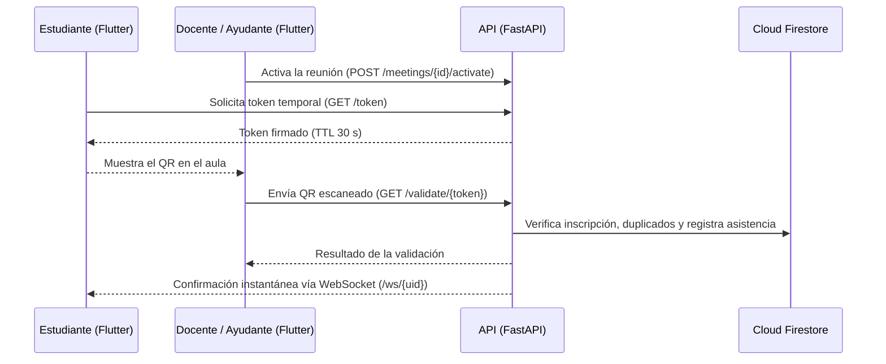
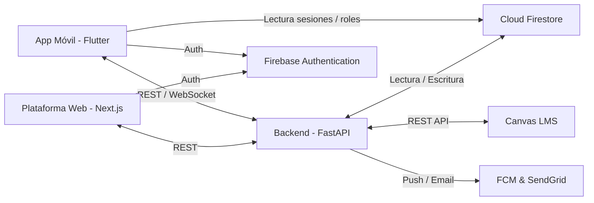

**Español** · [English](README.en.md) · [Caso de estudio en el portafolio](https://cristobal-nanjari.vercel.app/projects/udp-attendance)

# Sistema de Asistencia Académica

Plataforma full stack para el registro presencial de asistencia universitaria mediante códigos QR dinámicos de corta duración, confirmación en tiempo real por WebSocket, analítica académica e integración bidireccional con **Canvas LMS**.

El estudiante **muestra** un token QR firmado con vigencia de 30 segundos desde la aplicación móvil y el docente o ayudante lo **escanea** desde su dispositivo. Los registros alimentan la matriz de asistencia en la plataforma web, reportes diarios, alertas tempranas por umbral y sincronización de calificaciones hacia Canvas.

Desarrollado como memoria de **Ingeniería Civil en Informática y Telecomunicaciones** en la **Universidad Diego Portales (2025)**, tomando como caso de estudio su Facultad de Ingeniería y Ciencias.

> **Alcance de esta publicación:** monorepositorio consolidado para revisión de código y portafolio. El entorno productivo institucional está retirado (sin demo pública) y las credenciales originales fueron reemplazadas por plantillas `.env.example`.

---

## Flujo principal: de la clase al reporte

1. **Activación en aula:** el docente o ayudante selecciona la reunión vigente de su sección y activa la toma de asistencia (lo que también envía notificación push vía FCM a los estudiantes inscritos).
2. **Token QR dinámico (TTL 30 s):** el estudiante autenticado solicita un token firmado criptográficamente (`itsdangerous` / `URLSafeTimedSerializer`) y lo presenta como código QR con cuenta regresiva.
3. **Validación y confirmación en tiempo real:** el responsable escanea el QR; el backend verifica firma, expiración, inscripción en la sección y duplicados, registra la asistencia en Cloud Firestore y notifica al estudiante por **WebSocket**.
4. **Gestión, analítica y LMS:** en la plataforma web, docentes y administradores consultan o corrigen manualmente la matriz de asistencia (una clase no activada no penaliza al estudiante), revisan reportes diarios, generan cortes históricos (*snapshots*) de alerta temprana, exportan a CSV/Excel y sincronizan cursos y notas con Canvas LMS.

---

## Arquitectura y módulos del monorepositorio

Cada componente cuenta con su propia documentación técnica, mapa de código y guía de configuración local:

| Módulo | Stack principal | Responsabilidad | Documentación | Puntos de entrada |
| :--- | :--- | :--- | :--- | :--- |
| **[`mobile/`](mobile/)** | Flutter · Dart `^3.7.2` · Firebase | Login institucional, generación de QR temporal, WebSocket, activación de clases y escáner | [README móvil](mobile/README.md) | [`qr_generator.dart`](mobile/lib/qr_generator.dart) · [`qr_validator.dart`](mobile/lib/qr_validator.dart) |
| **[`backend/`](backend/)** | Python · FastAPI · Firestore · APScheduler | Tokens firmados, validación, permisos por rol, reportes, alertas, notificaciones y Canvas LMS | [README backend](backend/README.md) | [`back.py`](backend/back.py) · [`lms_canvas_client.py`](backend/lms_canvas_client.py) |
| **[`web/`](web/)** | Next.js `15.3.2` · React 19 · TypeScript · Tailwind v4 | Gestión académica, matriz de asistencia, analítica (`Recharts`), exportaciones CSV/XLSX y panel Canvas | [README web](web/README.md) | [`dashboard/`](web/src/app/dashboard/) · [`apiClient.ts`](web/src/lib/apiClient.ts) |

---

## Vistas del sistema

### Aplicación móvil (Flutter)

<table>
  <tr>
    <td align="center" width="50%">
      
       
      <strong>Token QR dinámico:</strong> expiración de 30 s, refresco automático y confirmación vía WebSocket.
    </td>
    <td align="center" width="50%">
      
       
      <strong>Activación en aula:</strong> selección de reunión vigente y habilitación de toma de asistencia por el docente.
    </td>
  </tr>
</table>

### Plataforma web administrativa (Next.js)

<strong>Reportes y Analíticas:</strong> comparativa por curso y tipo de sesión (Cátedra, Ayudantía, Laboratorio), KPIs globales y ranking de secciones en riesgo.

<strong>Matriz de Asistencia:</strong> seguimiento por sesión con distinción de clases no activadas (<code>-</code>), corrección manual auditada y exportación CSV.

Capturas originales de la memoria de título (2025) sobre datos de prueba sintéticos. El código QR mostrado corresponde a un token de prueba expirado de un backend retirado. Hay capturas adicionales en <a href="mobile/README.md"><code>mobile/README.md</code></a> y <a href="web/README.md"><code>web/README.md</code></a>.

---

## Piloto y validación en la memoria

- **Piloto en clases reales:** probado en **5 secciones académicas (~40 estudiantes por sección)** junto al profesor guía.
- **Evaluación documentada:** la memoria (2025) incluye el estudio de dimensionamiento para la facultad, la matriz de validación funcional/seguridad y pruebas de carga sobre datos sintéticos. La documentación completa y el PDF de la memoria están disponibles en el [caso de estudio del portafolio](https://cristobal-nanjari.vercel.app/projects/udp-attendance).
- **Alertas tempranas:** calculadas mediante cortes históricos (*snapshots*) y umbral configurable de porcentaje de asistencia (no constituyen un modelo predictivo).

---

## Ejecución local (entorno aislado)

El código, los diagramas y las capturas pueden revisarse directamente sin credenciales. Para ejecutar cada componente en un entorno propio y aislado (sin apuntar a servicios institucionales), revisa las instrucciones detalladas en el README de cada carpeta:

| Módulo | Requisitos principales | Guía detallada |
| :--- | :--- | :--- |
| `backend/` | Python 3 + `venv`, proyecto Firebase propio (`GOOGLE_APPLICATION_CREDENTIALS`) y `backend/.env` | [`backend/README.md`](backend/README.md) |
| `web/` | Node.js compatible con Next.js `15.3.2`, npm y `web/.env.local` | [`web/README.md`](web/README.md) |
| `mobile/` | Flutter estable (`Dart ^3.7.2`), FlutterFire (`firebase_options.dart`) y `--dart-define=API_BASE_URL=...` | [`mobile/README.md`](mobile/README.md) |

> Antes de exponer cualquier despliegue propio en red, revisa la configuración de dominio institucional (`@mail.udp.cl`), las tareas programadas de `APScheduler`, las reglas de seguridad de Firestore y la autorización del endpoint WebSocket.

---

## Autoría y licencias

- **Autor:** **Cristóbal Nanjarí** — [Portafolio](https://cristobal-nanjari.vercel.app/) · [Caso de estudio](https://cristobal-nanjari.vercel.app/projects/udp-attendance) · [GitHub](https://github.com/cristobal-nan)
- **Origen:** consolidación en monorepositorio de los tres repositorios originales desarrollados para la memoria *Propuesta y desarrollo de sistema integral de registro de asistencia a clases en línea* (UDP, 2025).
- **Licencia:** todos los derechos reservados por el autor mientras no se incorpore un archivo `LICENSE` en el repositorio (publicado para revisión de portafolio). Las dependencias conservan sus respectivas licencias; ver [aviso de Flutter](docs/notices/Flutter.txt).
