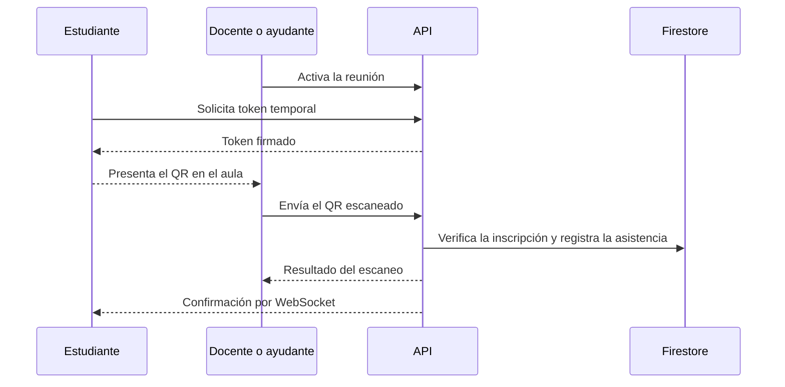
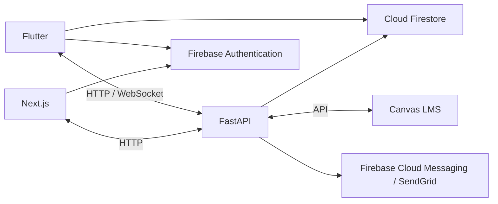
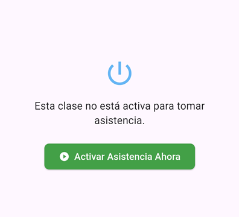
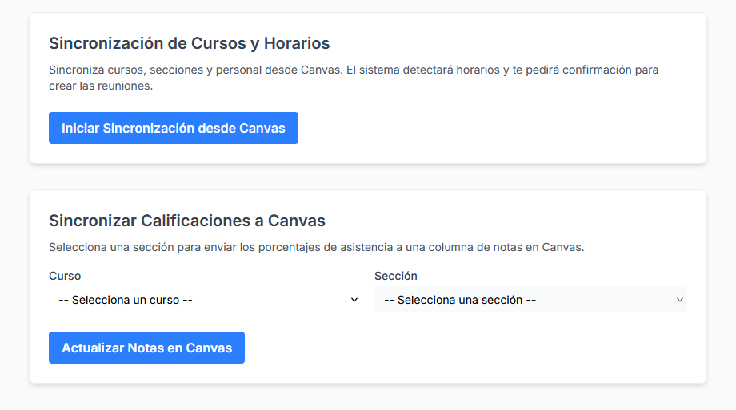

# Sistema de asistencia académica

**Español** · [English](README.en.md) · [Proyecto en el portafolio](https://cristobal-nanjari.vercel.app/projects/udp-attendance)

Una aplicación móvil registra la asistencia a clases presenciales; una plataforma web permite a docentes y administrativos consultar y corregir el registro por sección. El estudiante **muestra** su código QR y el docente o ayudante lo **escanea**. Los mismos registros alimentan reportes, alertas por baja asistencia y la integración con Canvas LMS.

Desarrollado como memoria de Ingeniería Civil en Informática y Telecomunicaciones de la Universidad Diego Portales (2025), tomando como caso de estudio su Facultad de Ingeniería y Ciencias. **Estado:** edición de portafolio para revisión de código. El backend original está retirado y no hay demo en línea.

## De la clase al reporte

1. El docente o ayudante habilitado selecciona y activa la reunión de su sección.
2. El estudiante solicita un token firmado de corta duración y lo muestra como QR. El backend comprueba firma, vigencia, inscripción y duplicados cuando el responsable lo escanea.
3. La asistencia queda asociada a la reunión en Firestore. El estudiante recibe confirmación mediante WebSocket. Cuando no puede usar el teléfono, el docente puede corregir el registro desde la matriz web de una reunión activa.
4. La web calcula porcentajes por tipo de reunión. Una clase que no se activó no cuenta como ausencia. Los reportes diarios y las alertas por umbral permiten revisar la asistencia durante el semestre.

## Arquitectura y código

| Componente | Responsabilidad | Dónde empezar |
|---|---|---|
| [Móvil](mobile/) · Flutter / Dart | Inicio de sesión, QR temporal, activación de clases y escáner | [Generación](mobile/lib/qr_generator.dart) · [Validación](mobile/lib/qr_validator.dart) |
| [Backend](backend/) · Python / FastAPI | Validación de asistencia, permisos, reportes, notificaciones e integración LMS | [API](backend/back.py) · [Cliente Canvas](backend/lms_canvas_client.py) |
| [Web](web/) · Next.js / React / TypeScript | Gestión de cursos y secciones, matriz filtrable, analítica y exportaciones CSV/XLSX | [Panel](web/src/app/dashboard/) · [Cliente HTTP](web/src/lib/apiClient.ts) |

La integración con Canvas permite importar cursos, docentes, estudiantes y horarios, y publicar porcentajes de asistencia como calificaciones en tareas del curso. Las alertas tempranas se basan en un umbral configurable; no son predicciones de rendimiento académico.

## Interfaces del proyecto de título

| Activar la asistencia | Escanear el QR del estudiante |
|---|---|
|  |  |

Recortes de las figuras B.17, B.18 y B.7 de la memoria (2025). Muestran el estado histórico de las interfaces; no contienen un QR utilizable ni listados de estudiantes.

## Piloto y alcance de la evaluación

Según el autor, su profesor guía utilizó el sistema en un piloto en **5 secciones, con aproximadamente 40 estudiantes por sección**. Este dato describe el alcance del piloto, no un recuento de usuarios únicos. La memoria incluye un estudio de dimensionamiento y un plan de pruebas. No se presentan mediciones de carga ni latencia verificadas para esta edición.

## Revisión local y requisitos de ejecución

El código, los diagramas y las capturas se pueden revisar sin credenciales. Los siguientes comandos describen los puntos de entrada por componente; **no constituyen una demo validada**. No apuntar a servicios institucionales ni usar credenciales del proyecto original.

| Directorio | Configuración para un entorno propio y aislado | Comandos de referencia |
|---|---|---|
| `mobile/` | Flutter estable con Dart `^3.7.2`; Android SDK o macOS/Xcode para iOS. Generar `lib/firebase_options.dart` y configuración nativa con FlutterFire para un proyecto propio. Proporcionar la URL de la API accesible desde el dispositivo. | `flutter pub get` · `flutter run --dart-define=API_BASE_URL=http://10.0.2.2:8000` (emulador Android) |
| `backend/` | Entorno virtual Python; versión no fijada. Ver [plantilla de entorno](backend/.env.example). Se requieren una clave de firma nueva y un archivo de credenciales externo al repositorio. Revisar el planificador antes de arrancar: puede escribir en Firestore y emitir notificaciones. | `python -m pip install -r requirements.txt` · `python -m uvicorn back:app --host 127.0.0.1 --port 8000` |
| `web/` | Node compatible con Next.js 15.3.2 y npm. Configurar `.env.local` a partir de la [plantilla web](web/.env.example). Las variables `NEXT_PUBLIC_*` llegan al navegador. | `npm ci` · `npm run dev` · `npm run build` |

El acceso original exige cuentas del dominio académico. Un proyecto Firebase nuevo por sí solo no crea perfiles, permisos, reglas de Firestore ni un entorno de prueba. Antes de ofrecer una demo por red, habría que aislar tareas periódicas, Canvas, correo y notificaciones, y verificar la autorización del WebSocket. No se certificaron builds Android/iOS, web ni flujos de extremo a extremo en esta consolidación.

## Historia, autoría y licencias

La memoria *Propuesta y desarrollo de sistema integral de registro de asistencia a clases en línea* documenta el diseño original. Esta edición posterior reúne los tres componentes independientes con sus propios manifiestos y archivos de dependencias; sustituye las configuraciones de despliegue originales y conserva las interfaces históricas como evidencia. El historial Git de esta edición comienza con la consolidación.

Autor: **Cristóbal Nanjarí** · [Ficha del proyecto](https://cristobal-nanjari.vercel.app/projects/udp-attendance). La licencia del código propio está pendiente de elección. Las dependencias y plantillas conservan sus licencias respectivas; ver el [aviso de Flutter](docs/notices/Flutter.txt).
