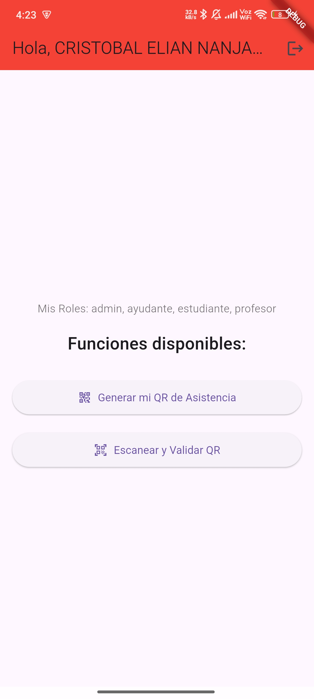
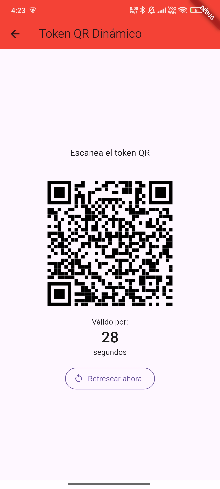
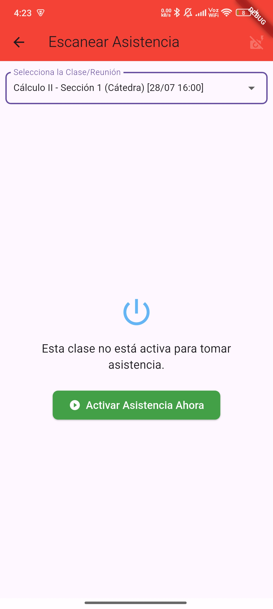

[← Volver al README principal](../README.md) · [English overview](../README.en.md)

# Mobile — Aplicación Móvil de Asistencia (Flutter)

Aplicación móvil multiplataforma (**Android e iOS**) construida en **Flutter / Dart** para el flujo presencial en aula: autenticación institucional con Google, presentación de tokens QR dinámicos para estudiantes y activación/escaneo de clases para docentes y ayudantes.

---

## Estructura del código (`lib/`)

| Archivo | Responsabilidad |
| :--- | :--- |
| [`lib/main.dart`](lib/main.dart) | Validación de `API_BASE_URL` (`--dart-define`), inicialización de Firebase, formato de fechas `es_CL`, configuración de FCM (`setupFCM`), `AuthWrapper` y utilidad `_preventScreenshots()` con `no_screenshot`. |
| [`lib/login_page.dart`](lib/login_page.dart) | Inicio de sesión con Google Sign-In + Firebase Auth restringido al dominio institucional (`hostedDomain: "mail.udp.cl"`). |
| [`lib/home_page.dart.dart`](lib/home_page.dart.dart) | Suscripción en tiempo real a los roles del usuario en Firestore (`users/{uid}`), guardado del `fcmToken` y navegación condicional según rol (`estudiante`, `profesor`, `ayudante`, `admin`). |
| [`lib/qr_generator.dart`](lib/qr_generator.dart) | Solicitud autenticada a `GET /token`, renderizado del QR (`qr_flutter`), cuenta regresiva y autorrefresco cada 30 s, y escucha de confirmación en tiempo real vía WebSocket (`/ws/{userId}`). |
| [`lib/qr_validator.dart`](lib/qr_validator.dart) | Carga de reuniones vigentes del día según `responsibleUIDs` (filtrando solo *Ayudantía* si el usuario es únicamente ayudante), activación de clase (`POST /meetings/{id}/activate`) y escaneo QR con cámara y linterna (`mobile_scanner`) contra `GET /validate/{token}?meetingId=...`. |

> Nota sobre protección de pantalla: `_preventScreenshots()` está implementado en [`lib/main.dart`](lib/main.dart) mediante el paquete `no_screenshot`, pero su invocación en `initState()` se encuentra comentada en esta edición de repositorio.

---

## Capturas de la aplicación

<table>
  <tr>
    <td align="center" width="33%">
      
      <br />
      <sub>Inicio dinámico según roles</sub>
    </td>
    <td align="center" width="33%">
      
      <br />
      <sub>Token QR dinámico (TTL 30 s)</sub>
    </td>
    <td align="center" width="33%">
      
      <br />
      <sub>Activación de reunión en aula</sub>
    </td>
  </tr>
</table>

---

## Requisitos y configuración local (entorno aislado)

- **Flutter estable** con **Dart `^3.7.2`** (ver [`pubspec.yaml`](pubspec.yaml)).
- Android SDK (emulador o dispositivo físico) o macOS + Xcode para iOS.
- Proyecto Firebase propio configurado con **FlutterFire CLI** para generar `lib/firebase_options.dart` y los archivos nativos (`google-services.json` / `GoogleService-Info.plist`), excluidos intencionalmente de este repositorio.

```bash
flutter pub get
flutter run --dart-define=API_BASE_URL=http://10.0.2.2:8000
```

> - En emulador Android, `10.0.2.2` apunta al `localhost` de la máquina anfitriona; en dispositivo físico usa la IP local o URL HTTPS accesible desde el teléfono.
> - Si `API_BASE_URL` no es una URL HTTP(S) válida, la aplicación muestra una pantalla de aviso al iniciar en lugar de conectarse a un servidor por defecto.
> - Para probar con cuentas fuera de `@mail.udp.cl`, ajusta la validación de dominio en [`lib/login_page.dart`](lib/login_page.dart) y crea los documentos de rol en `users/{uid}` en tu Firestore de prueba.
