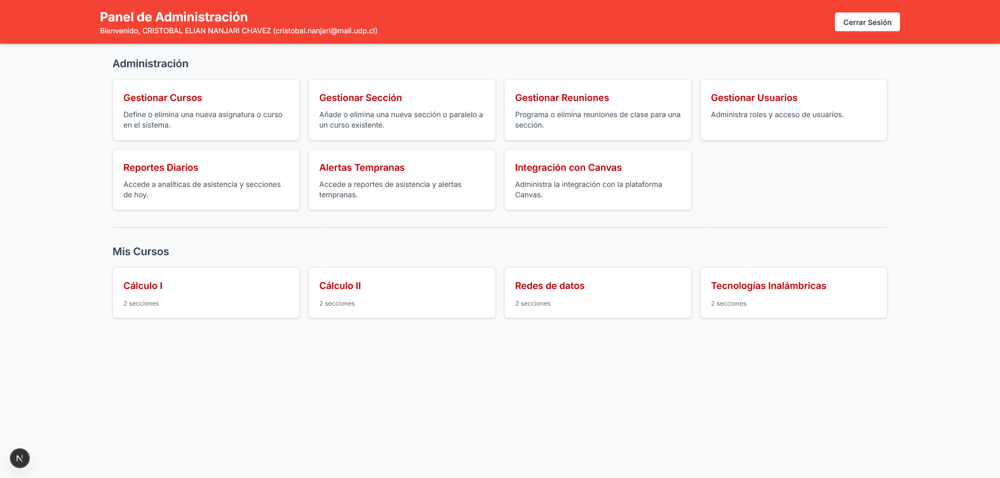
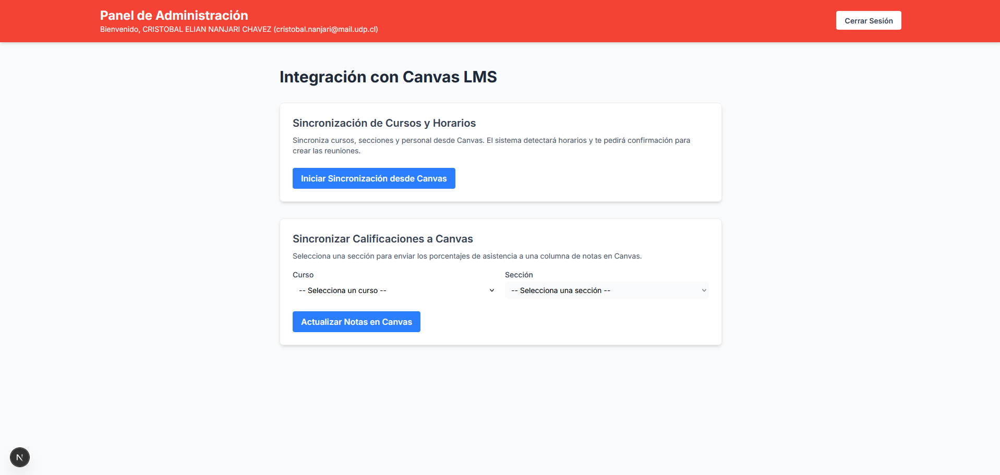
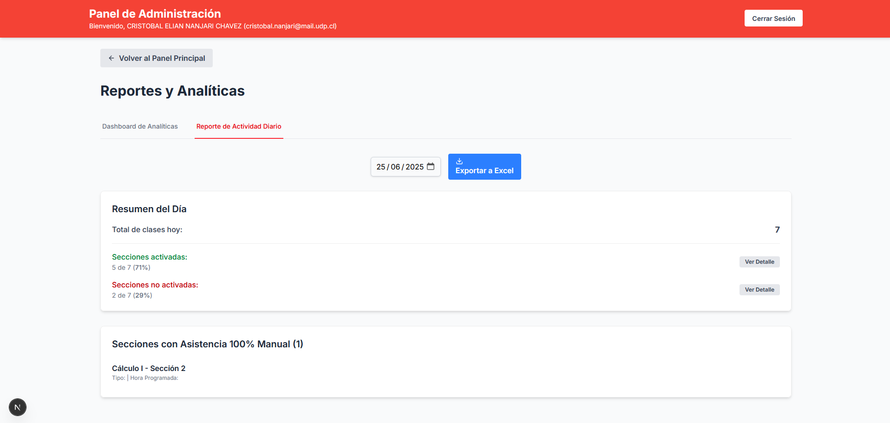
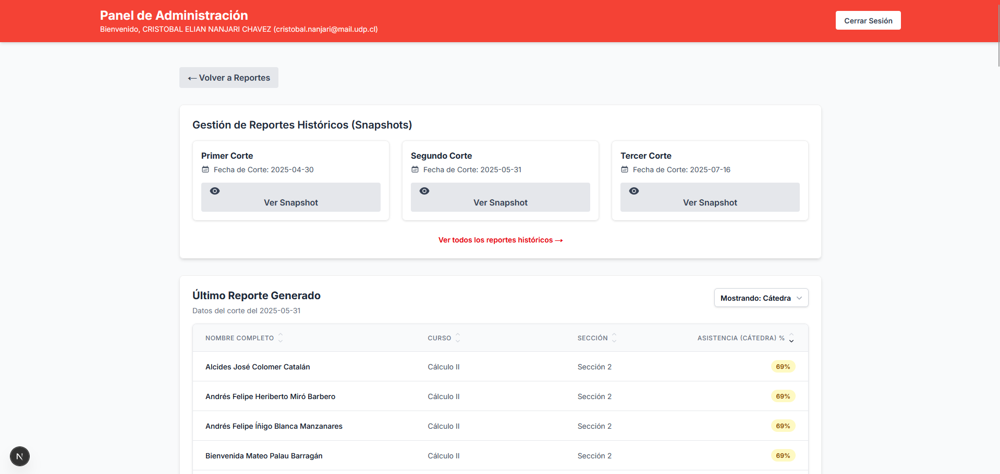

[← Volver al README principal](../README.md) · [English overview](../README.en.md)

# Web — Plataforma Administrativa y de Analítica (Next.js)

Aplicación web en **Next.js 15 (App Router)**, **React 19**, **TypeScript** y **Tailwind CSS v4** orientada a docentes y administradores para gestionar cursos, secciones y horarios, revisar y corregir matrices de asistencia, consultar reportes diarios y alertas tempranas, y operar la integración con **Canvas LMS**.

---

## Stack y dependencias principales

- **Framework y UI:** Next.js `15.3.2`, React `19`, TypeScript `^5`, Tailwind CSS `^4`, `@headlessui/react`, `@heroicons/react`, `lucide-react`.
- **Autenticación:** Firebase Web SDK (`firebase` `^11.7.1`) con contexto y guarda de rutas (`AuthContext.tsx`, `AuthGuard.tsx`).
- **Visualización y exportación:** `recharts` (gráficos comparativos), `papaparse` (CSV) y `xlsx` (planillas Excel).

---

## Estructura de módulos (`src/`)

```text
src/
├── app/
│   ├── login/                                       # Acceso autenticado con Firebase Auth
│   └── dashboard/
│       ├── page.tsx                                 # Panel principal (administración y cursos del docente)
│       ├── analytics/                               # Analítica consolidada
│       ├── course/[courseId]/sections/              # Listado de secciones por asignatura
│       ├── section/[sectionId]/attendance/          # Matriz de asistencia filtrable + corrección manual + CSV
│       ├── section/[sectionId]/edit-schedule/       # Edición de horarios y generación de reuniones
│       ├── meeting/[meetingId]/                     # Detalle de asistencia por sesión individual
│       └── admin/
│           ├── manage-courses/                      # CRUD de cursos
│           ├── manage-sections/                     # CRUD de secciones e inscripciones
│           ├── manage-meetings/                     # Programación individual y por lotes
│           ├── manage-users/                        # Alta de usuarios e importación masiva
│           ├── lms-integration/                     # Sincronización de cursos/horarios y notas con Canvas
│           └── reports/
│               ├── daily/                           # Reporte diario y detalle de clases activadas / no activadas
│               ├── early-warning/                   # Alertas tempranas por umbral y cortes históricos
│               └── snapshots/[snapshotId]/          # Detalle de snapshot histórico
├── components/                                      # Navbar, modales, formularios de horario y listas
├── context/                                         # AuthContext y AuthGuard
├── lib/
│   ├── apiClient.ts                                 # Wrapper authenticatedFetch (Bearer token + validación de NEXT_PUBLIC_API_BASE_URL)
│   ├── firebaseConfig.ts                            # Inicialización de Firebase Web SDK desde env vars
│   └── utils.ts                                     # Utilidades de formato
└── types/                                           # Tipos compartidos TypeScript
```

---

## Vistas adicionales de la plataforma web


<sub><strong>Panel principal:</strong> accesos administrativos y listado de asignaturas asignadas al docente.</sub>


<sub><strong>Integración con Canvas LMS:</strong> importación de cursos/horarios y publicación de porcentajes de asistencia como calificaciones.</sub>


<sub><strong>Reporte diario:</strong> monitoreo de activación de clases, alertas de asistencia 100% manual y exportación a Excel.</sub>


<sub><strong>Alertas tempranas:</strong> cortes históricos (<em>snapshots</em>) y listado de estudiantes bajo el umbral configurado (datos sintéticos de prueba).</sub>

---

## Variables de entorno

Copia [`.env.example`](.env.example) a `.env.local` en un entorno aislado. Todas las variables `NEXT_PUBLIC_*` se exponen al navegador:

| Variable | Obligatoria | Descripción |
| :--- | :---: | :--- |
| `NEXT_PUBLIC_API_BASE_URL` | Sí | URL base HTTP(S) del backend FastAPI (ej. `http://127.0.0.1:8000`). |
| `NEXT_PUBLIC_FIREBASE_API_KEY` | Sí | API key pública de tu proyecto Firebase Web. |
| `NEXT_PUBLIC_FIREBASE_AUTH_DOMAIN` | Sí | Dominio de autenticación Firebase. |
| `NEXT_PUBLIC_FIREBASE_PROJECT_ID` | Sí | ID del proyecto Firebase. |
| `NEXT_PUBLIC_FIREBASE_APP_ID` | Sí | App ID de Firebase Web. |
| `NEXT_PUBLIC_FIREBASE_STORAGE_BUCKET` | No | Bucket de almacenamiento (opcional para el flujo de Auth). |
| `NEXT_PUBLIC_FIREBASE_MESSAGING_SENDER_ID` | No | Sender ID de mensajería (opcional). |
| `NEXT_PUBLIC_FIREBASE_MEASUREMENT_ID` | No | Measurement ID de Analytics (opcional). |

---

## Comandos de desarrollo y compilación

```bash
npm ci
npm run dev     # Servidor local en http://localhost:3000
npm run lint    # Verificación ESLint
npm run build   # Compilación de producción
```
